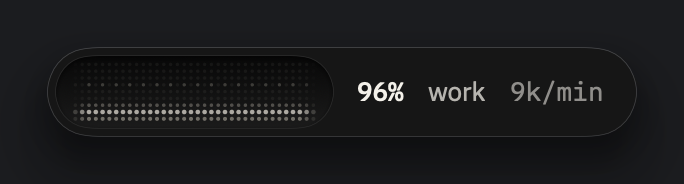
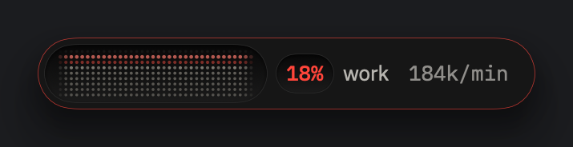
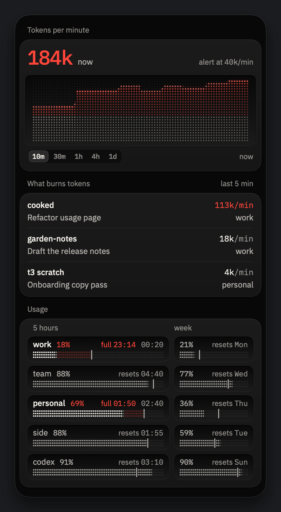
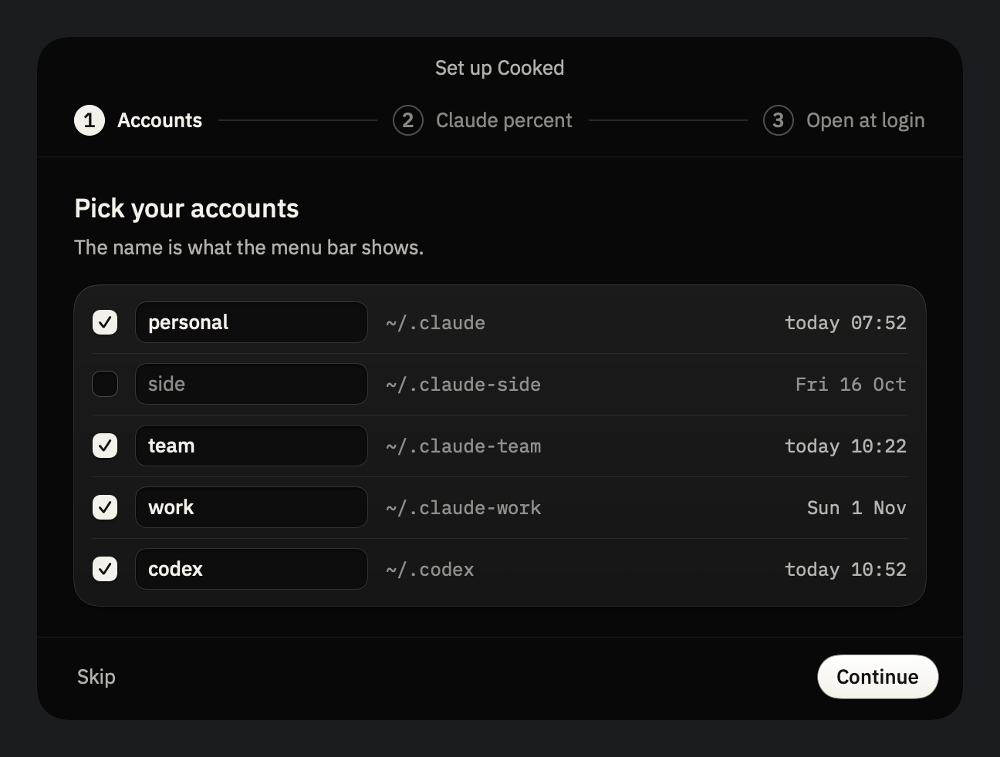

<p align="center"></p>

# Cooked

Know you're cooked before Claude does. Cooked shows the live usage of your Claude and Codex accounts (5-hour window,
week, tokens per minute) in an island under the menu bar.

https://github.com/user-attachments/assets/76cc20e9-02e8-474c-a5da-a25ba4d345ce

## How it works

### 1. The island tells you when you go too fast

One line under the menu bar: what is left of the 5-hour window, the account at work and its tokens per minute. When you
burn tokens faster than usual, the percent and the edge turn red.

<p> </p>

### 2. Click it to see what burns tokens

Tokens per minute, from the last 10 minutes to the last day, the threads that burn the most in the last 5 minutes, and when each account is
full. Click a thread to open it where it runs: T3 Code, Codex, the Claude app or Terminal.

<p></p>

### 3. Pick your accounts once

Cooked finds every Claude and Codex folder on your Mac. It reads them on your Mac and sends nothing anywhere.

<p></p>

## Install

Needs macOS 26 or later, on a Mac with Apple silicon.

1. Download `Cooked-<version>.zip` from [Releases](https://github.com/0xCaso/cooked/releases) and open it.
2. Drag **Cooked** to Applications in Finder, then open it from there. Opened from Downloads, macOS runs it from a
   hidden copy, and open at login can lose it.
3. macOS says it cannot check Cooked for malware, and does not open it. Click **Done**.
4. Open **System Settings → Privacy & Security**, scroll to Security, and click **Open Anyway** next to "Cooked was
   blocked". Confirm with your password. macOS asks only this first time.

Why the warning: Cooked has no paid Apple Developer ID, so Apple has not checked it. The source is all here; to build
it yourself, see "Build and run". Each release lists the zip's SHA-256: `shasum -a 256 Cooked-<version>.zip` must
print the same.

## Use

- The first launch opens **Set up Cooked**: tick the Claude and Codex accounts to watch, choose whether Cooked shows
  the Claude 5-hour percent, and whether it opens at login.
- The island sits under the menu bar. Click it to open or close the popover; Esc, a click elsewhere or any key closes
  it. Drag it to move it: the position is kept per screen.
- Right-click the island: **Data** (Live, Demo: calm, Demo: peak), **Glass** (System, Clear, Darker), **Settings…**,
  **Quit Cooked**. Opening Cooked again while it runs opens the popover.
- When a number is missing, the popover says why at the top, with its one fix.

## Where the numbers come from

All read-only, every 5 s, nothing leaves your Mac.
- **Tokens per minute**: the session files of each account, `~/.claude*/projects/**/*.jsonl` and
  `~/.codex/sessions/**/*.jsonl`, counted as input − cached input + output.
- **Codex percents**: the rate limits Codex writes in its session files.
- **Claude percents**: Claude Code gives them only to its status line. If you say yes in setup, Cooked puts a small
  script in front of your status line command (your status line looks the same) and the script copies the numbers to
  `~/Library/Application Support/Cooked/bridge/`. Settings → Claude percent disconnects it and gives back your old
  status line. API keys have no 5-hour limit, so an API key account shows only tokens per minute.

## Remove

Settings → General → **Remove Cooked's changes…** gives back your old status line, stops Cooked opening at login and
deletes the bridge script. Then quit Cooked (right-click the island) and move it from Applications to the Bin.

## Build and run

Needs macOS 26 or later and Xcode 26 or later (Swift 6.2+).

```sh
scripts/run.sh                 # builds in debug, creates build/Cooked.app and launches it
scripts/run.sh release         # the same in release
scripts/install.sh             # release build installed as /Applications/Cooked.app, then launched
scripts/release.sh 0.1.0       # build/Cooked-0.1.0.zip for a GitHub release, and its SHA-256
swift test                     # tests
```

`scripts/run.sh` quits the copy that is already open before it launches the new one. The app has no Dock icon: to
quit it, right-click the island → "Quit Cooked", or run `pkill -x Cooked`.

For checks from the terminal:
- `Cooked --limits` prints every account's limits and the notices as the app reads them.
- `Cooked --snapshots <dir>` renders the island, the popover and every notice from demo data to PNG; add `--live` for
  the live data.
- `Cooked --feed demoCalm|demoPeak|live [--open]` starts on that feed (and opens the popover).
- `Cooked --statusline status|connect|disconnect` shows or changes the status line bridge of each Claude account.

Design rules: `design/DESIGN.md`.

## Structure

- `Package.swift`: SwiftPM package, one executable and the tests.
- `Sources/Cooked/`: `CookedApp` (launch, no Dock), `IslandPanel` (borderless window under the menu bar, click-through, drag), `IslandPlacement` and `PositionStore` (where the window goes), `Views/` (island, popover, surfaces, motion), `Dots/` (the dot-matrix charts), `Model/` (usage snapshot, session file readers, status line bridge, notices, live mapping, demo data), `Style/` (palette, type, contrast).
- `Resources/Info.plist`: `LSUIElement` for the app with no Dock icon.
- `scripts/`: `bundle.sh` (builds the .app), `run.sh` (bundle + launch), `install.sh` (release into /Applications), `release.sh` (the release zip).

## License

MIT, see [LICENSE](LICENSE). The IBM Plex fonts in `Resources/Fonts/` are under the SIL Open Font License.
